

# D O K U H A
### 読破 — *Dokuha: To Read All The Way Through*

**A modern, distraction-free mobile reader for Manga, Manhwa, Manhua, Comics, and Webnovels.**  
Crafted with Compose Multiplatform for fluid 60+ FPS performance exclusively on Android and iOS (desktop target removed).

---

  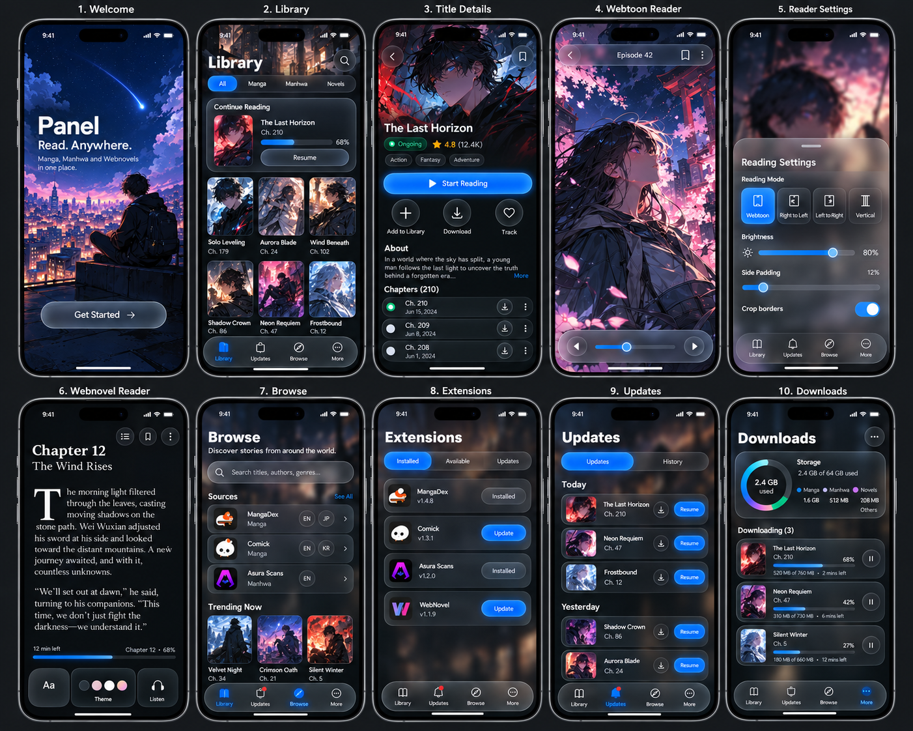

---

## The Reading Experience

Dokuha is built from the ground up for mobile readers who demand speed, tactile elegance, and complete focus on the story. No desktop bloat, no banner ads, and no visual clutter.

### Liquid Glass Aesthetic & Multi-Concept Splash
A custom translucent chrome engine powered by AGSL `RuntimeShader` (Android API 33+) and directional specular bevel/sheen Canvas rendering (Android `< 33` & iOS). Includes 6 animated splash concepts paired with rotating format badges (`MANHWA` → `MANHUA` → `MANGA` → `COMIC` → `WEBNOVEL`).

### Quad-Mode Reading Engine & Hands-Free Autoscroll
Read any publication in its native format:
- **Webtoon Strip**: Continuous vertical scrolling with seamless inline next-chapter transition gaps, end-of-series cards, and a floating autoscroll pill (`1x` / `2x` / `3x`) with touch-to-pause.
- **RTL Manga**: Authentic right-to-left page turning with instant gesture flip.
- **LTR Comic**: Traditional left-to-right paging with snappy page transitions.
- **Vertical Paging**: Discrete, snapping page-by-page vertical reading.

### Editorial Webnovel Studio & Background TTS
Long-form prose features illuminated drop-caps, customizable typefaces (System, Classic Serif, Modern Sans, Monospace), adjustable line-height, four color palettes (Dark Obsidian, Warm Sepia, Light Cream, Pitch OLED Black), and native background Text-to-Speech (`TextToSpeech` on Android, `AVSpeechSynthesizer` on iOS) with HTML/Markdown sanitization and live paragraph tracking.

### Comic ↔ Novel Adaptation Bridge & Smart Catch-up
Jump between a title's comic/manhwa adaptation and its counterpart webnovel from the details screen, or review spoiler-free **"Previously On..."** recaps up to your last read chapter.

### Universal Discovery, Sandboxed Extensions & Anti-Bot Solver
- **Instant Search & Filtering**: Debounced title/author/genre search and multi-parameter catalog filtering.
- **Unified QuickJS Extension Runtime**: Runs Mangayomi, LNReader, and Paperback extension adapters via `quickjs-kt` across Android and iOS with SHA-256 repo validation and SSRF guards.
- **Two-Stage Cloudflare Resolution**: Silent headless `WebView` (Android) / off-screen `WKWebView` (iOS) clearance plus an interactive `ChallengeWebView` fallback.
- **Persistent Diagnostics**: Rolling multiplatform log persistence (`Okio`) with an in-app Log Viewer (`LogViewerScreen`).

### Privacy by Architecture & Build Memory
- **Hardware-Backed Encryption**: Tracker tokens and credentials use Android KeyStore and Apple Keychain.
- **Direct Cloud Sync**: Connect directly to AniList, MyAnimeList, and Kitsu with zero intermediary servers.
- **Memory-Tuned Builds**: `gradle.properties` sets `-Xmx2048M` (Gradle) and `-Xmx1024M` (Kotlin daemon) for stable local and CI mobile builds.

---

## Gallery

*Native captures rendered with 100% shared Compose Multiplatform code:*

### Onboarding & Library

<table>
  <tr>
    <td align="center" width="33%">
      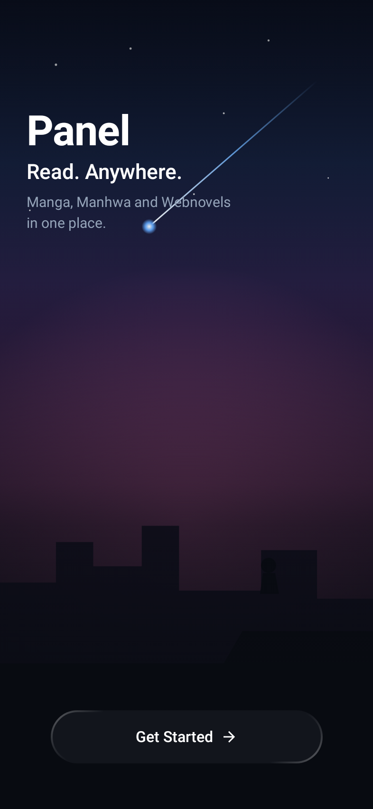 
      <b>Welcome & Immersion</b> 
      Starry sky canvas and luxury entry
    </td>
    <td align="center" width="33%">
      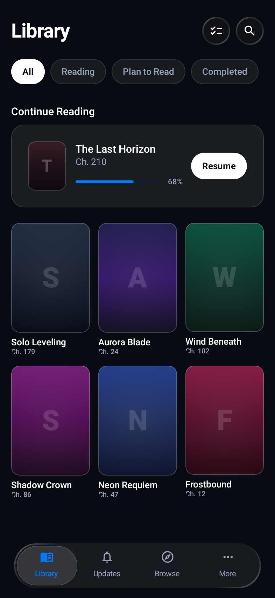 
      <b>Dynamic Library</b> 
      Quick-resume glass card and manga grid
    </td>
    <td align="center" width="33%">
      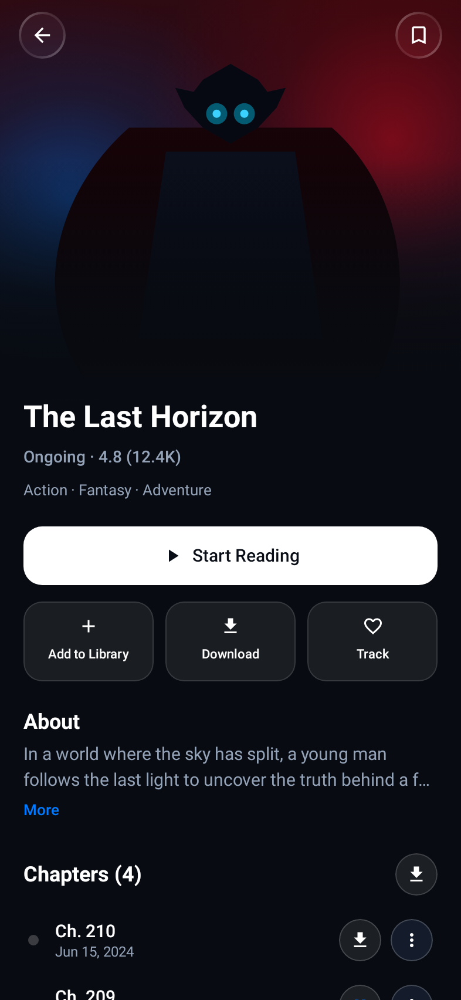 
      <b>Title Details Hub</b> 
      Cinematic header, synopsis, and chapter list
    </td>
  </tr>
</table>

### Multi-Format Reader

<table>
  <tr>
    <td align="center" width="33%">
      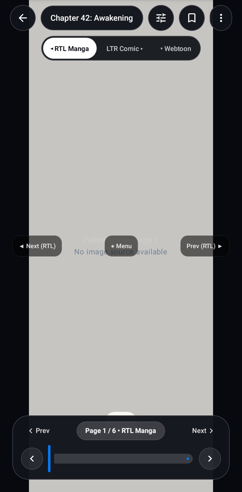 
      <b>Webtoon & Manga Reader</b> 
      Multi-mode strip, RTL paging, and floating HUD
    </td>
    <td align="center" width="33%">
      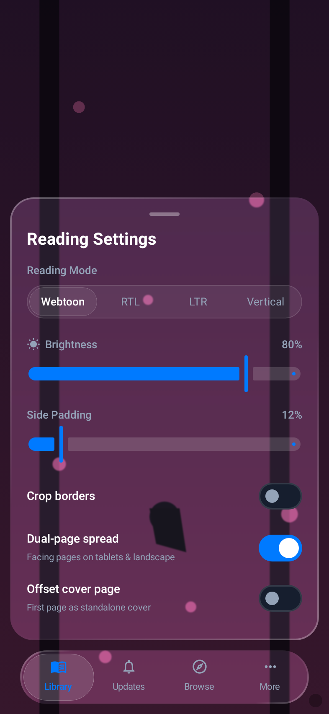 
      <b>Reader Settings Sheet</b> 
      Mode selectors, dimmer, and margin sliders
    </td>
    <td align="center" width="33%">
      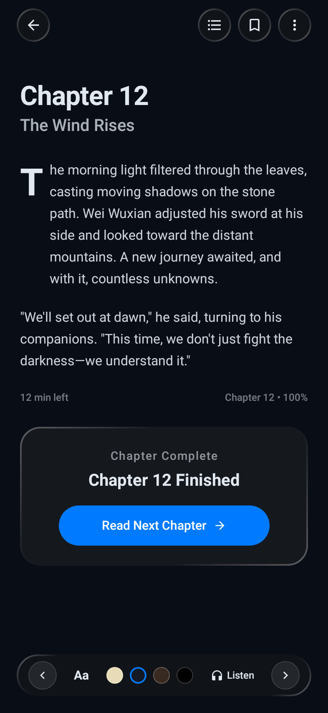 
      <b>Editorial Webnovel Reader</b> 
      Illuminated drop-caps and reading palettes
    </td>
  </tr>
</table>

### Discovery, Updates & Storage

<table>
  <tr>
    <td align="center" width="25%">
      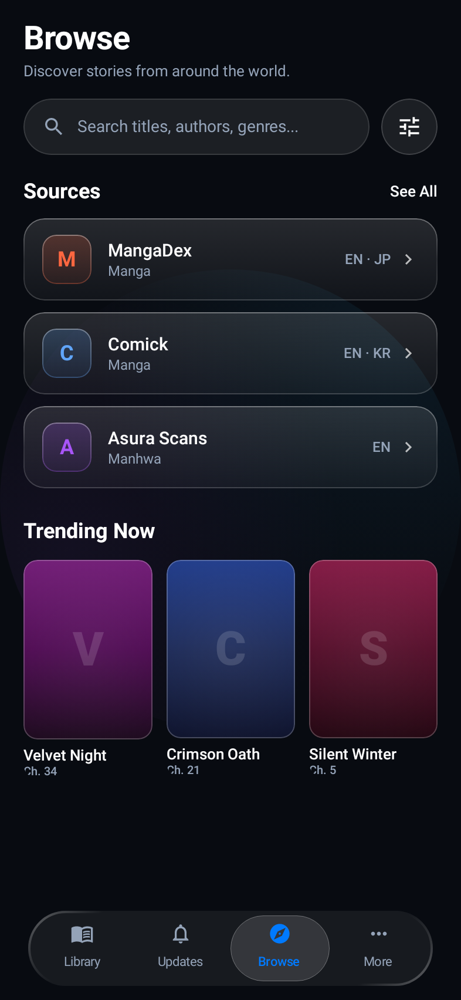 
      <b>Browse Hub</b> 
      Live search and filter bottom sheet
    </td>
    <td align="center" width="25%">
      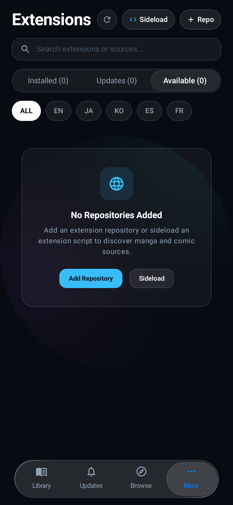 
      <b>Extensions</b> 
      Verified repository management
    </td>
    <td align="center" width="25%">
      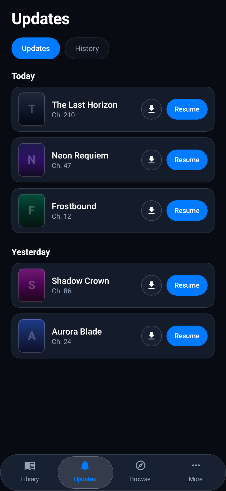 
      <b>Daily Updates</b> 
      Chronological chapter timeline
    </td>
    <td align="center" width="25%">
      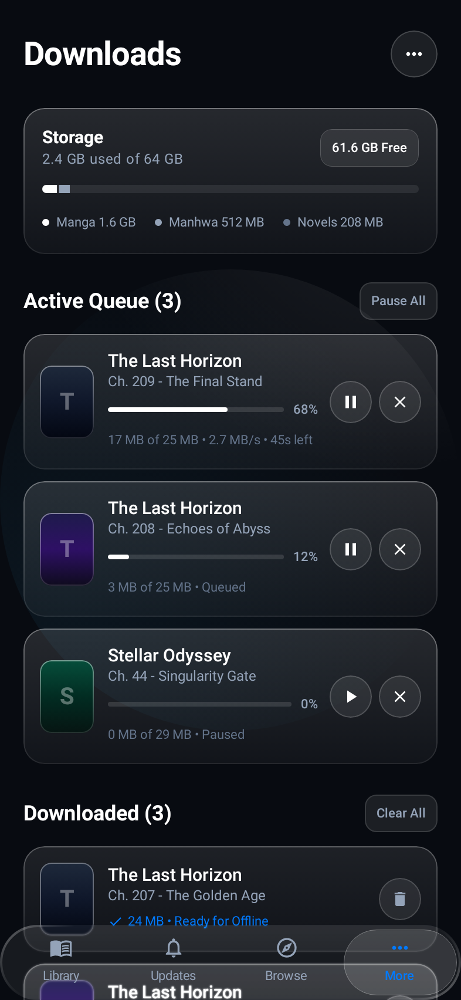 
      <b>Storage & Queue</b> 
      Horizontal capsule bar and queue
    </td>
  </tr>
</table>

### Profile & System Controls

<table>
  <tr>
    <td align="center" width="25%">
      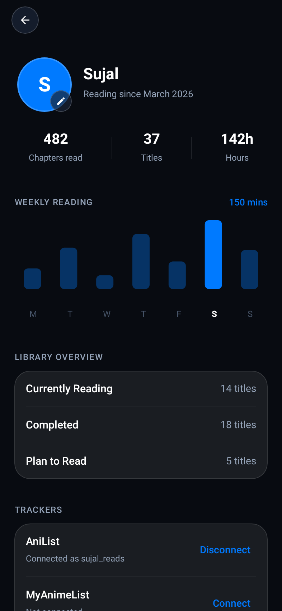 
      <b>Reader Profile</b> 
      Reading statistics and linked trackers
    </td>
    <td align="center" width="25%">
      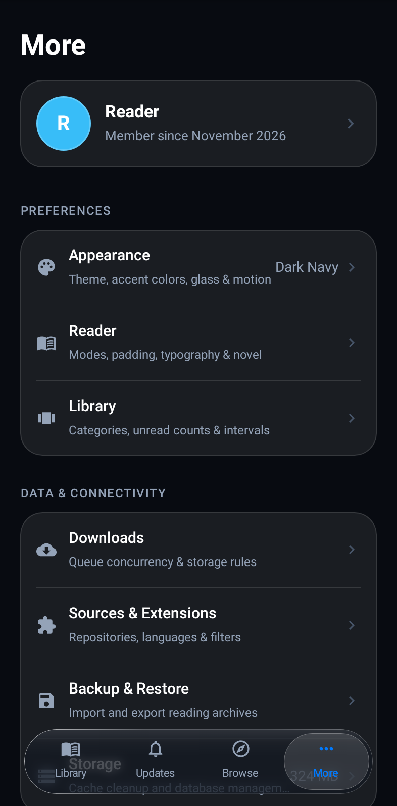 
      <b>More Hub</b> 
      Profile card and preferences index
    </td>
    <td align="center" width="25%">
      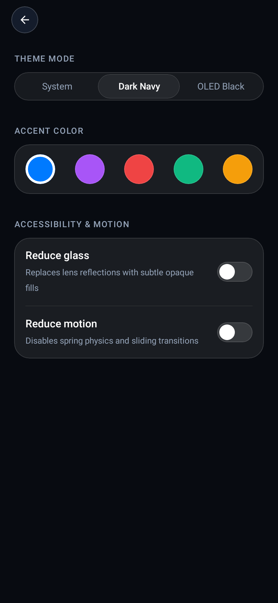 
      <b>Appearance</b> 
      Themes, accent colors, and motion settings
    </td>
    <td align="center" width="25%">
      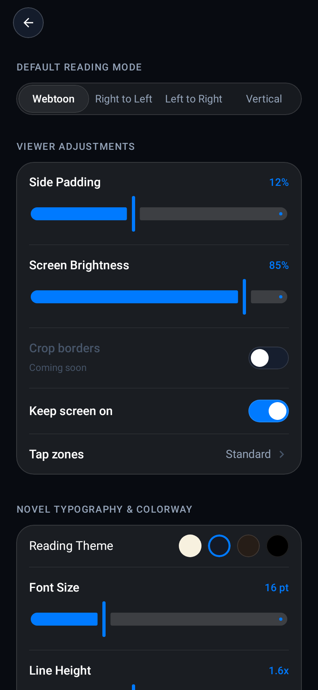 
      <b>Reader Defaults</b> 
      Default reading modes and live preview
    </td>
  </tr>
</table>

---

## Engineering & Architecture

For detailed technical specifications, project structure, the clear-lens rendering engine implementation, hardware security contracts, and build steps, see:

**[Dokuha Architecture & Engineering Specification](../docs/ARCHITECTURE.md)**

---

  Crafted for readers around the world.

