<div align="center">


# 🌌 PANEL (読破 — Dokuha) — UI / UX Module
### *Read Anywhere. To Read All The Way Through.*

[](https://kotlinlang.org/)
[](https://www.jetbrains.com/lp/compose-multiplatform/)
[]()
[](https://voyager.adriel.cafe/)
[](https://github.com/chrisbanes/haze)
[](https://insert-koin.io/)
[](https://github.com/takahirom/roborazzi)

<p align="center">
  <b>A next-generation, cross-platform reader for Manga, Manhwa, and Webnovels.</b><br>
  Built with Kotlin Multiplatform (KMP) and Compose Multiplatform (CMP) for silky 60+ FPS performance on Android & iOS.
</p>

---

<p align="center">
  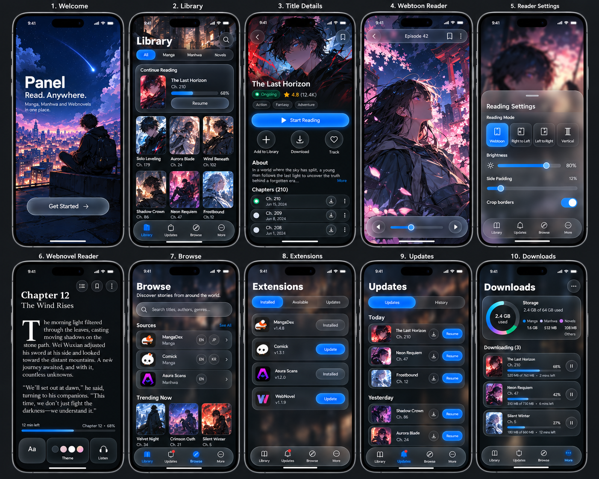
</p>

</div>

---

## ✨ Features & Visual Highlights

### 1. 🌌 Frosted Glass & Midnight Aesthetic
Deep obsidian navy backgrounds, luminous electric blue accents, and real-time backdrop blur powered by **Haze**. Every navigation bar, bottom sheet, and floating control feels tactile, modern, and fluid.

### 2. 📖 All-in-One Reading Experience
- **Continuous Webtoon Reader**: Seamless vertical scrolling strip with floating episode capsules and progress scrubbers.
- **Manga Engine**: Support for right-to-left (RTL), left-to-right (LTR), and vertical page flips.
- **Editorial Webnovel Reader**: Custom drop-cap typography, estimated read-time indicators, and 4 curated colorways (Dark Navy, Sepia, Cream, OLED Pitch Black).

### 3. 🧩 Modular Source & Extension Ecosystem
Browse sources across languages with localized tags, filter installed extensions, track updates in chronological sections, and manage queued downloads.

### 4. 📊 Storage & Offline Management
Interactive custom canvas donut chart visualizing disk space distribution across Manga, Manhwa, Novels, and other files with per-task pause/resume download controls.

---

## 📱 Screen Showcase (Native Roborazzi Captures)

All screens rendered pixel-perfectly with 100% shared Compose Multiplatform code:

<div align="center">

### Onboarding & Library

<table>
  <tr>
    <td align="center" width="33%">
      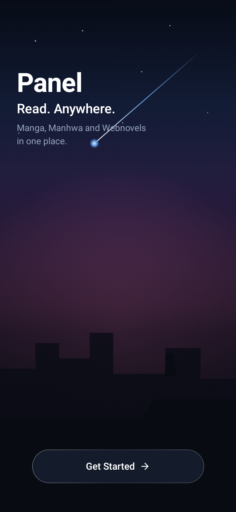<br />
      <b>01. Welcome & Immersion</b><br />
      <i>Starry night sky canvas & city silhouettes</i>
    </td>
    <td align="center" width="33%">
      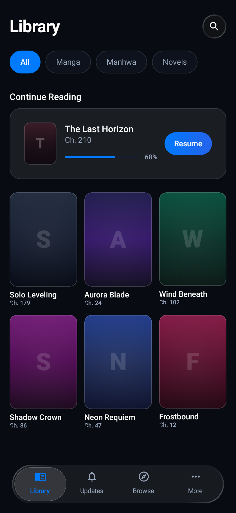<br />
      <b>02. Dynamic Glass Library</b><br />
      <i>Quick-resume glass card & manga grid</i>
    </td>
    <td align="center" width="33%">
      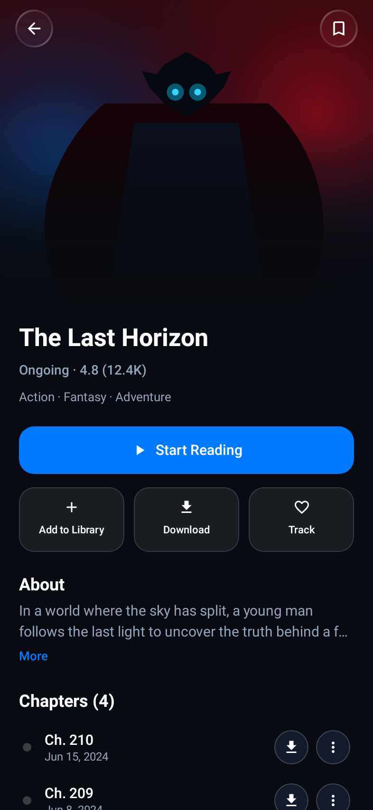<br />
      <b>03. Title Details Hub</b><br />
      <i>Cinematic glow header & chapter feeds</i>
    </td>
  </tr>
</table>

### Multi-Format Reader Experience

<table>
  <tr>
    <td align="center" width="33%">
      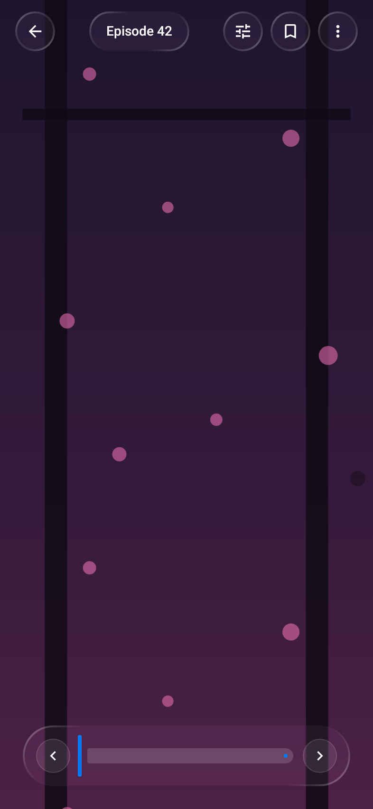<br />
      <b>04. Webtoon Reader</b><br />
      <i>Continuous vertical strip & floating HUD</i>
    </td>
    <td align="center" width="33%">
      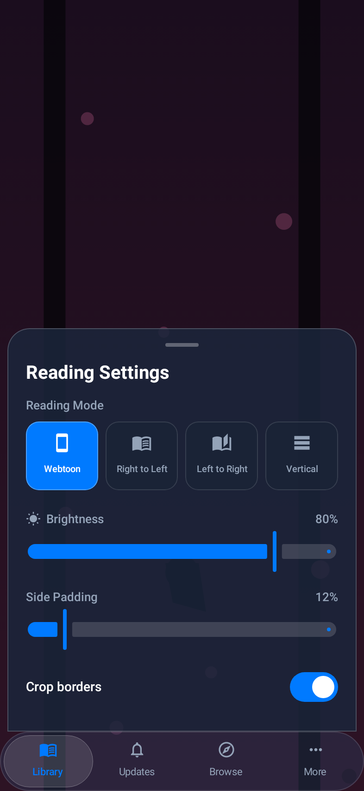<br />
      <b>05. Reader Settings Sheet</b><br />
      <i>Mode selector tiles & ambient sliders</i>
    </td>
    <td align="center" width="33%">
      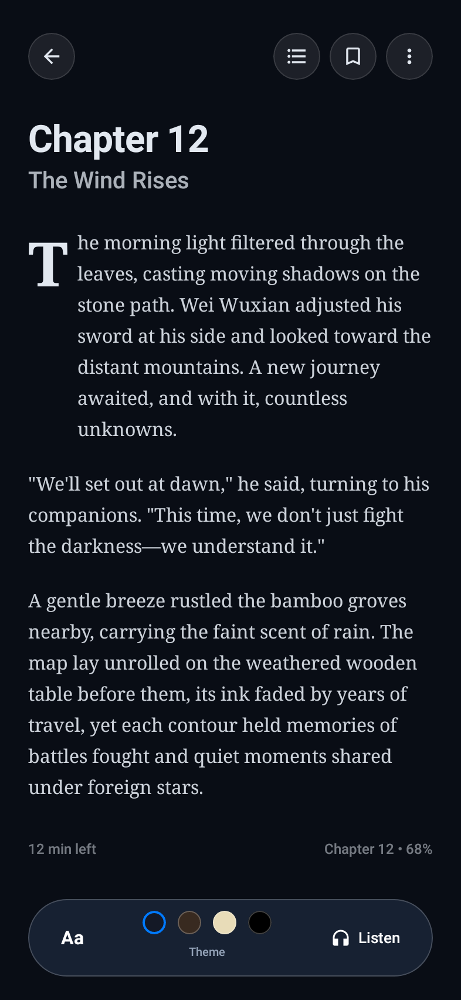<br />
      <b>06. Editorial Webnovel Reader</b><br />
      <i>Illuminated drop-caps & palette bar</i>
    </td>
  </tr>
</table>

### Discovery, Extensions & Management

<table>
  <tr>
    <td align="center" width="25%">
      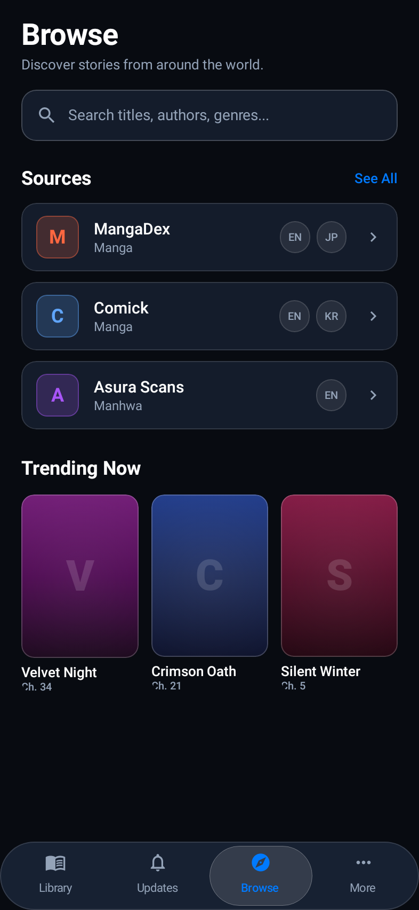<br />
      <b>07. Browse Hub</b><br />
      <i>Source directory & trending carousel</i>
    </td>
    <td align="center" width="25%">
      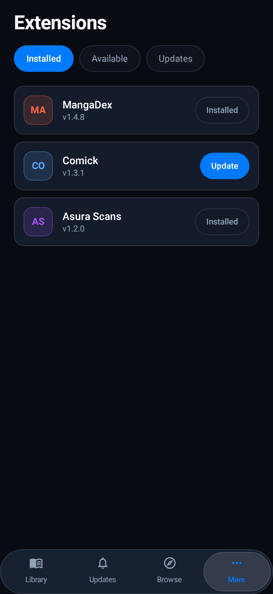<br />
      <b>08. Extensions</b><br />
      <i>Modular catalog & updates</i>
    </td>
    <td align="center" width="25%">
      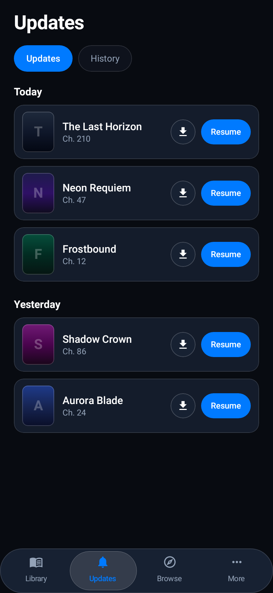<br />
      <b>09. Daily Updates</b><br />
      <i>Date-grouped chapter timeline</i>
    </td>
    <td align="center" width="25%">
      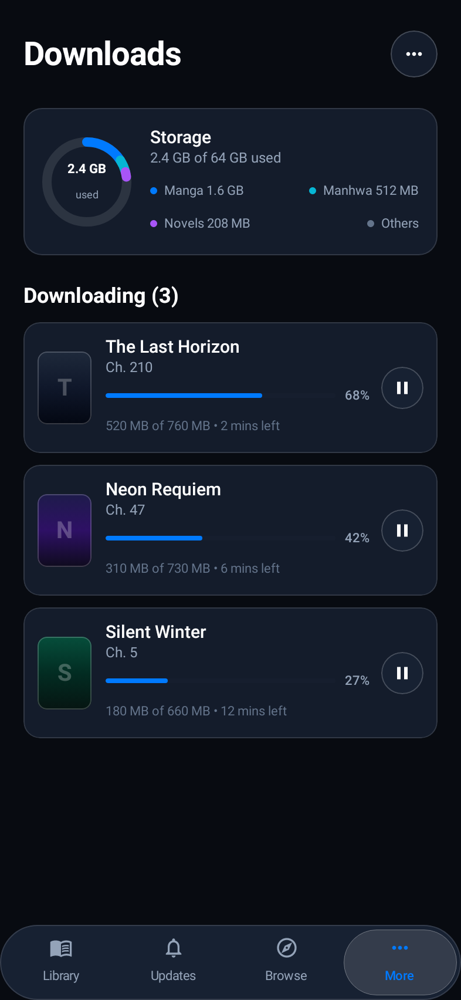<br />
      <b>10. Storage & Queue</b><br />
      <i>Canvas donut chart & queue</i>
    </td>
  </tr>
</table>

### Profile & Settings Hub

<table>
  <tr>
    <td align="center" width="25%">
      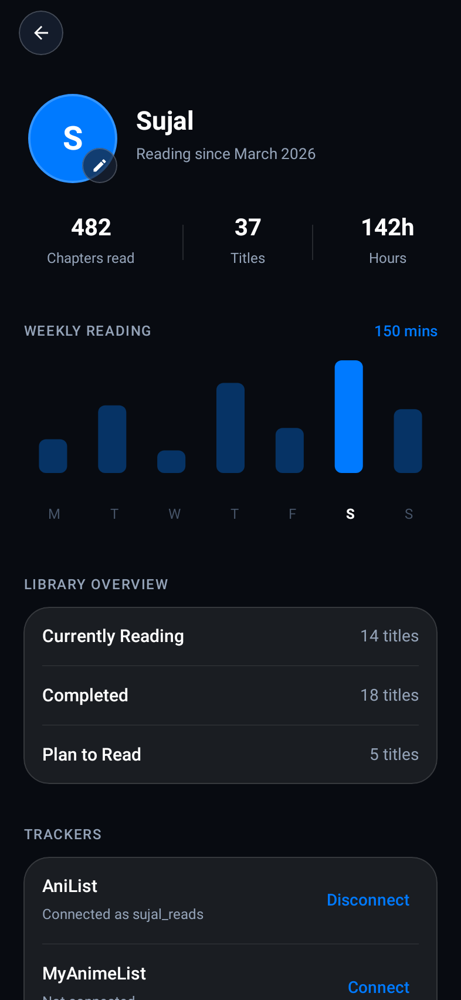<br />
      <b>11. Reader Profile</b><br />
      <i>Avatar, activity bar chart & trackers</i>
    </td>
    <td align="center" width="25%">
      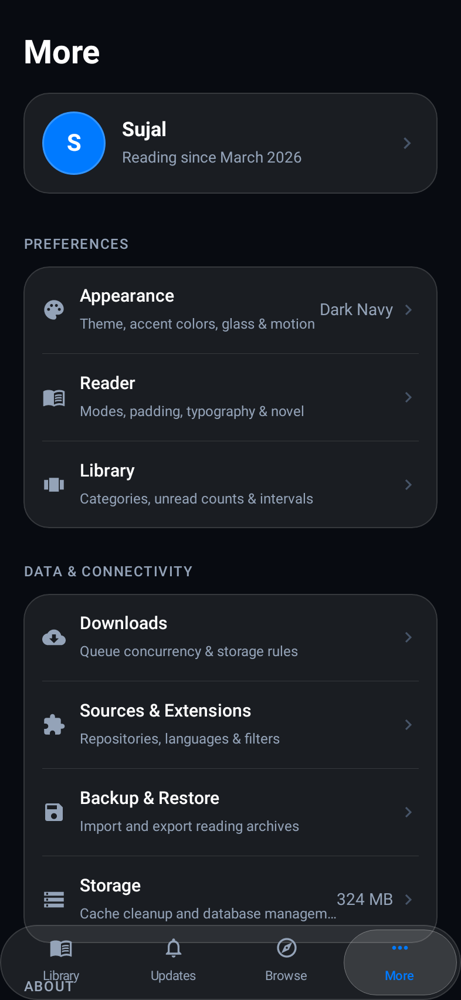<br />
      <b>12. More Hub</b><br />
      <i>Profile card & settings categories</i>
    </td>
    <td align="center" width="25%">
      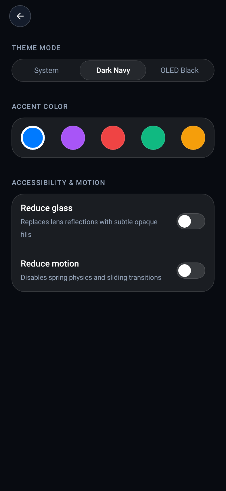<br />
      <b>13. Appearance</b><br />
      <i>Theme, accent colors & accessibility</i>
    </td>
    <td align="center" width="25%">
      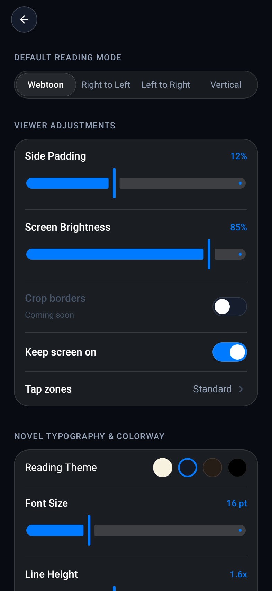<br />
      <b>14. Reader Defaults</b><br />
      <i>Reading mode & live novel preview</i>
    </td>
  </tr>
</table>

</div>

---

## 🏗 Architecture & Code Structure

Panel follows clean, decoupled architecture ready for cross-team backend handoff:

```
composeApp/src/commonMain/kotlin/
├── core/
│   ├── di/                 # Dependency injection modules (Koin)
│   └── source/             # Domain source models (Manga, Chapter, Page, NovelContent)
├── data/
│   └── mock/               # PanelRepository contract & mock implementation
├── io/panel/reader/        # App entry point, Voyager TabNavigator
└── ui/
    ├── theme/              # Design tokens (Colors, Typography, Spacing, Shapes)
    ├── components/         # GlassContainer, FrostedCapsule, PillButtons, BottomNavBar
    └── screens/
        ├── welcome/        # WelcomeScreen (Screen 1)
        ├── library/        # LibraryScreen (Screen 2)
        ├── details/        # TitleDetailsScreen (Screen 3)
        ├── webtoonreader/  # WebtoonReaderScreen & ReaderSettingsSheet (Screens 4 & 5)
        ├── novelreader/    # NovelReaderScreen (Screen 6)
        ├── browse/         # BrowseScreen (Screen 7)
        ├── extensions/     # ExtensionsScreen (Screen 8)
        ├── updates/        # UpdatesScreen (Screen 9)
        └── downloads/      # DownloadsScreen (Screen 10)
```

### 🔌 Backend Handover Ready
All screens consume data strictly through the **`PanelRepository`** interface (`data/mock/MockRepositories.kt`). Backend developers can swap in SQLDelight, Ktor networking, Dex extension loaders, or Cloudflare bypass engines without touching UI composables.

---

## 🚀 Building & Testing

### Prerequisites
- JDK 17+
- Android Studio Ladybug+ / IntelliJ IDEA with Kotlin Multiplatform plugin

### Verify UI Compilation
```bash
./gradlew :composeApp:compileCommonMainKotlinMetadata
```

### Assemble Android APK
```bash
./gradlew :composeApp:assembleDebug
```

### Run Native Roborazzi Screenshot Verification
```bash
./gradlew :composeApp:recordRoborazziDebug
```

---

<div align="center">
  <sub>Crafted with passion for readers around the world.</sub>
</div>
