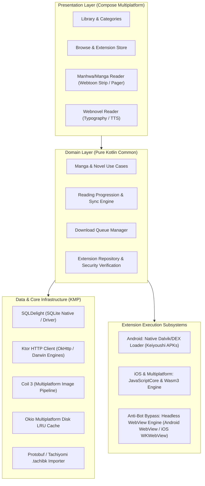
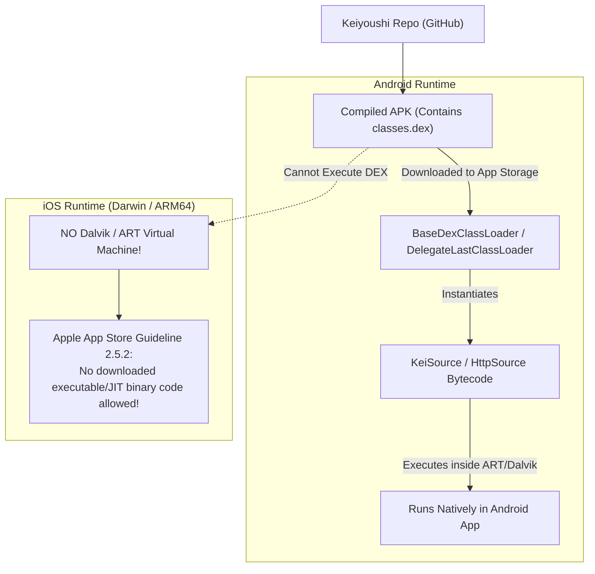
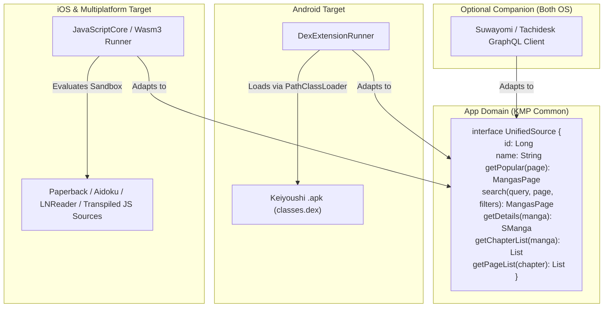
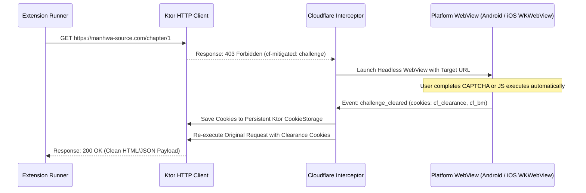
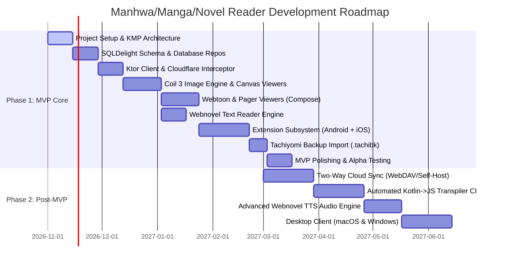
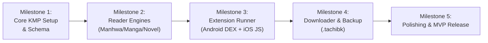

# Technical Architecture & Feasibility Report: Cross-Platform Manhwa, Manga & Webnovel Reader (KMP)

---

## Executive Summary & System Vision

This report analyzes the reference codebases—**Mihon** (the gold-standard Android reader) and **Keiyoushi Extensions** (the largest community-maintained extension ecosystem)—to outline the architecture for building a cross-platform (Android & iOS) manhwa, manga, and webnovel reader powered by **Kotlin Multiplatform (KMP)** and **Compose Multiplatform (CMP)**.



---

## 1. What Can Be Picked Up from Existing Readers (Deep Analysis of Mihon)

Mihon has refined Android reading UX and library management over nearly a decade. Its core architecture, data patterns, and reader rendering pipeline provide concrete foundations that can be adapted directly to a multiplatform codebase.

### 1.1 Architecture & Modular Structure
Mihon is organized into clean, decoupled Gradle modules:
- `source-api`: Pure interface definitions with minimal dependencies (`Source`, `CatalogueSource`, `HttpSource`, `ParsedHttpSource`, `SManga`, `SChapter`, `Page`, `FilterList`).
- `domain`: Pure business logic containing use cases (e.g., `GetLibrary`, `GetManga`, `GetChapters`, `SetMangaCategories`, `DownloadChapter`). Completely decoupled from UI and framework APIs.
- `data`: Infrastructure implementations—SQLDelight database, OkHttp network client, Protobuf serializers, download workers, and tracking services.
- `presentation-core` & `app`: UI components built in Jetpack Compose, state machines via ViewModels/MVI, and screen navigation.

**Takeaway for KMP:**
This clean separation makes KMP migration straightforward. `domain`, `data`, and `source-api` map directly to `commonMain`, while only platform-specific glue (such as classloading and low-level viewports) requires `androidMain` and `iosMain` actualization.

---

### 1.2 Data Model & Database Architecture (SQLDelight)
Mihon uses **SQLDelight** for type-safe database queries. SQLDelight is multiplatform-ready and supports Android (via `AndroidSqliteDriver`) and iOS (via `NativeSqliteDriver`).

The proven relational schema from Mihon to adopt:
- **`mangas`**: Stores source ID, URL key, title, artist, author, description, genre tags, status (ongoing/completed), thumbnail URL, favorite flag, viewer flags, and chapter display options.
- **`chapters`**: Foreign key to `mangas._id`, chapter URL, chapter name, date upload, date fetch, chapter index, read flag, bookmark flag, and last page read.
- **`categories` & `mangas_categories`**: Many-to-many relationship supporting custom user shelves, drag-and-drop manual ordering, and category-level update flags.
- **`history`**: Audit trail of read chapters with exact timestamps and last read page offsets for "Resume Reading" flows.
- **`tracks`**: Sync mapping table linking local manga IDs to remote tracking services (AniList, MyAnimeList, Kitsu, etc.), holding remote item IDs, remote URLs, total chapters, reading status, and user ratings.
- **`extension_repos`**: Manages dynamic third-party extension repository endpoints, signing keys, and metadata hashes.

---

### 1.3 The Reader Engine (Manhwa vs. Manga Mechanics)
Mihon's reader architecture separates rendering strategies into distinct viewers:

#### A. Webtoon / Manhwa Viewer (Continuous Vertical Strip)
Manhwa chapters are published as long continuous strips composed of dozens of sliced images (often 800×10,000+ px each).
- **Seamless Image Stitching**: The vertical viewer must render image slices with **0px margin/padding** between items, ensuring no visual seams appear between slices.
- **Memory Management & Tile Subsampling**: Loading 40 uncompressed 4K vertical slices simultaneously causes instant Out-Of-Memory (OOM) crashes. Mihon handles this using SubsamplingScaleImageView and recycler pools. For KMP, Coil 3 combined with a lazy viewport that decodes and unloads tiles dynamically based on the viewport position is required.
- **Crop Borders Filter**: Manhwa webtoons often have excessive white margins. Mihon provides an automatic border cropping algorithm that scans pixels along the outer edges to trim excess dead whitespace.
- **Side Padding & Zoom Constraints**: On wide screens (tablets, foldables, iPads), reading narrow strips causes severe eye strain. Mihon enforces configurable horizontal margins (e.g., 20%, 30%, or fixed width like 720dp) with smooth pinch-to-zoom.

#### B. Pager Viewer (Manga / Western Comics)
- **Reading Directions**: Right-to-Left (traditional Japanese Manga), Left-to-Right (Western comics/Manhua), and Vertical Page-by-Page.
- **Dual-Page Spread Logic**:
  - Automatically split wide landscape spreads into two portrait pages on phones.
  - Automatically join two consecutive portrait pages into a single dual-page spread on tablets and iPads in landscape mode.
- **Predictive Pre-fetching**: Mihon runs a sliding-window queue that prefetches $N$ pages ahead and $M$ pages behind based on the user's reading speed, with automatic network throttling if the device runs low on memory.

#### C. Novel Viewer (Webnovel / Light Novel Innovation over Mihon)
Mihon does **not** natively support text-based webnovels (only images/local CBZ/EPUB images). To make this application an all-in-one reader, the novel engine needs:
- **Reflowable Text Layout**: Pure text rendering engine (Compose Multiplatform `Text` / `Paragraph` with custom layout measure passes).
- **Typography & Formatting**: Dynamic font selection (custom `.ttf`/`.otf`), adjustable font size, line height, paragraph spacing, letter spacing, and edge padding.
- **Visual Themes**: Pure OLED black, sepia, warm parchment, slate dark, and solarized modes.
- **Reading Aids**: Auto-scroll with adjustable speed, reading progress percentage indicator, estimated reading time, and native Text-to-Speech (TTS) using platform audio engines (`android.speech.tts.TextToSpeech` on Android, `AVSpeechSynthesizer` on iOS).

---

### 1.4 Downloader & Offline Storage System
Mihon’s download subsystem handles unreliable mobile networks:
- **Queue-based Architecture**: Download requests are persisted in a queue table.
- **Concurrency & Rate-Limiting**: Parallel downloads per source are strictly limited (typically 1–2 concurrent requests) to avoid triggering Cloudflare or IP bans from source hosts.
- **Automatic Chapter Organization**: Files are stored on disk in structured hierarchies:
  ```
  /storage/downloads/[Source Name]/[Manga Title]/[Chapter Name].[cbz|ext]
  ```
  Images can be saved as flat image folders or packaged on the fly into standard **CBZ (ZIP)** archives containing a `ComicInfo.xml` metadata file.
- **Background Downloader Constraints**: Network type validation (e.g., download only on unmetered Wi-Fi) and battery level checks.

---

### 1.5 Tracking Services (Two-Way Metadata Sync)
Mihon provides two-way sync with remote tracker services:
- **AniList**: GraphQL API with token authentication.
- **MyAnimeList**: OAuth2 REST API with PKCE flow.
- **Kitsu, Shikimori, Bangumi, MangaUpdates**.
- **Behavior**: When chapter $X$ is read locally, the app sends a mutation to the tracker updating progress to $X$. If the tracker status is "Planning" or "Reading", it automatically marks the entry as "Completed" when the final chapter is reached.

---

### 1.6 Backup & Migration Format (`.tachibk`)
Mihon uses a **Protobuf-based, gzip-compressed backup file** format (`.tachibk`).
- Backs up categories, manga library details, chapter read statuses, history timestamps, tracking credentials, and custom extension repo URLs.
- **Compatibility Advantage**: By integrating the `.tachibk` Protobuf schema into our KMP app, existing Tachiyomi and Mihon users can restore their entire 500+ title library into our app with one tap.

---

### 1.7 Anti-Bot & Cloudflare Bypass Architecture
As seen in `references/mihon/core/common/.../CloudflareInterceptor.kt`:
- Online manga sources are heavily protected by **Cloudflare Turnstile, DDoS-Guard, and JavaScript challenges**.
- Mihon checks for HTTP `403` / `503` responses or `cf-mitigated: challenge` headers.
- When detected, it spins up an invisible background Android `WebView` that loads the target URL, executes the challenge JavaScript, listens for the completion event via injected scripts, extracts the resolved `cf_clearance` cookie and User-Agent, updates the application's persistent `CookieJar`, and automatically replays the original failed HTTP request.

---

## 2. How to Support Popular Extensions on Both Android and iOS

Supporting popular extensions (specifically the Keiyoushi ecosystem) on both platforms is the central architectural hurdle of this project.

### 2.1 The Problem Statement & Technical Constraints



1. **How Keiyoushi Extensions Work**:
   As inspected in `references/extensions-source`:
   - Extensions are written in Kotlin and compiled via Android Gradle Plugin (`com.android.application`) and KSP into `.apk` files containing Dalvik executable bytecode (`classes.dex`).
   - Extensions depend on `keiyoushi.core`, `okhttp3`, `jsoup`, `kotlinx.serialization`, and Android system classes (`android.app.Application`, `android.content.Context`, `android.webkit.WebView`, `android.util.Log`).
   - Android loads these APKs at runtime using `DelegateLastClassLoaderCompat` (which extends Android's native `BaseDexClassLoader`).
2. **The iOS Barrier**:
   - **No Dalvik/ART VM**: iOS does not have Dalvik or ART. It executes compiled Mach-O ARM64 binaries. A raw `.dex` or `.apk` cannot run natively on iOS.
   - **Apple App Store Review Guidelines (Guideline 2.5.2)**: Apps cannot download, install, or execute binary code (JIT, native binaries) at runtime. However, Apple **explicitly permits** running downloaded code inside an **interpreted sandbox**, specifically:
     - **JavaScript** executed via Apple's built-in `JavaScriptCore` framework.
     - **WebAssembly** run within an interpreter without runtime machine-code generation (e.g., Wasm3).

---

### 2.2 Technical Solutions & Evaluation

We evaluate four potential approaches:

| Strategy | Implementation Mechanism | Android Compatibility | iOS Compatibility | App Store Compliance | Maintenance Effort |
| :--- | :--- | :--- | :--- | :--- | :--- |
| **Strategy A: Dual Engine (Native DEX + JS/WASM)** | Native DexClassLoader on Android; JavaScriptCore/Wasm on iOS | Native 100% | Full (via JS/Wasm sources) | 100% Compliant | Moderate |
| **Strategy B: Automated Kotlin->WASM/JS Transpiler** | CI service compiles Keiyoushi Kotlin sources to `.wasm` / `.js` | Native or Wasm | Runs via Wasm3 / JSC | 100% Compliant | High initial, automated after |
| **Strategy C: Embedded Dalvik Interpreter on iOS** | Embed a Dalvik bytecode interpreter (e.g., in Rust/C) on iOS | Native | High complexity, slow | Risky (flags Guideline 2.5.2) | Very High |
| **Strategy D: Headless Companion Server (Suwayomi)** | Connect to remote desktop/home server running Tachidesk | Remote | Remote | 100% Compliant | Low for app, requires user setup |

---

### 2.3 The Recommended Architecture: The Multi-Engine Unified Source Framework

The most practical path forward that provides **100% access to Keiyoushi on Android** while giving **iOS users complete standalone capability** is the **Multi-Engine Unified Source Framework**.



#### Engine 1: Android Native Dex Loader
On Android, implement the exact mechanism used by Mihon:
- Download the official Keiyoushi APK from `https://raw.githubusercontent.com/keiyoushi/extensions/repo/index.min.json`.
- Store the `.apk` in the app's private files directory (`context.filesDir.resolve("exts")`).
- Use `dalvik.system.DelegateLastClassLoader` to load the entry class (annotated with `@Source` or listed in `AndroidManifest.xml`).
- Inject the host app's OkHttpClient, Jsoup, and Injekt dependencies into the classloader context.

#### Engine 2: iOS JavaScript & WebAssembly Engine
For iOS (and as a secondary cross-platform engine on Android), implement an interpreted script runtime:
1. **JavaScriptCore Binding**:
   - iOS provides `JavaScriptCore.framework` natively with zero overhead.
   - We inject a sandboxed standard environment into the `JSContext`:
     - `http.get(url, headers)` / `http.post(url, headers, body)` backed by Ktor / `NSURLSession`.
     - `DOMParser` / `cheerio` binding (or an embedded fast HTML parser in JS or native C).
     - Crypto primitives (MD5, SHA256, AES) using Apple's `CommonCrypto`.
     - Local source storage / cookie jar access.
2. **Compatibility with Existing Rich JS Ecosystems**:
   - **Paperback (iOS)**: The leading iOS manga reader has hundreds of well-maintained TypeScript/JavaScript extensions for all major English and international manga/manhwa sites. By adopting an adapter for the Paperback v0.8/v0.9 extension API, iOS users immediately gain access to a mature, native iOS extension catalog.
   - **LNReader**: Open-source webnovel reader with over 150 plugins written in JavaScript for webnovels (NovelUpdates, RoyalRoad, Webnovel, ReadLightNovel). Adopting this JS interface gives our novel engine instant support for 100+ novel sources.
   - **Aidoku WASM**: Aidoku compiles Rust/TypeScript scrapers to `.wasm`. Using **Wasm3** (a high-performance, purely interpreted C-based WebAssembly interpreter), we can execute Aidoku `.wasm` extensions directly on iOS within App Store rules.

#### Engine 3: Automated Keiyoushi Kotlin-to-JS/WASM Transpilation Pipeline
Because Keiyoushi extensions are open source and follow a standardized DSL (`KeiSource`), we can maintain an automated GitHub Actions repository that:
1. Pulls upstream `keiyoushi/extensions-source`.
2. Compiles or transpiles the scraping logic to JavaScript / Kotlin/Wasm using the Kotlin Multiplatform compiler targeting `wasmJs` or `js`.
3. Publishes an `index.json` hosting `.js` / `.wasm` bundles that can be fetched by the iOS app alongside the Android APK repo.

---

### 2.4 Cloudflare & Anti-Bot Resolution on iOS vs. Android

Scrapers frequently encounter Cloudflare Turnstile verification. The cross-platform solution uses platform-native webviews:



- **On Android**: Use a hidden `android.webkit.WebView` with `WebViewCompat.addWebMessageListener` to detect Cloudflare success events, intercept the `cf_clearance` cookie via `CookieManager.getInstance()`, and resume the request.
- **On iOS**: Use an off-screen `WKWebView` with `WKScriptMessageHandler` and `WKHTTPCookieStore`. When `cf_clearance` appears in the cookie store, the interceptor saves it to the common Ktor `CookieStorage` and fulfills the coroutine continuation. If an interactive captcha requires manual touch, display a non-intrusive bottom sheet containing the `WKWebView` for 3 seconds until the user solves it.

---

### 2.5 Unified Extension Interface Specification

Here is the common Kotlin interface bridging all extension engines:

```kotlin
package core.source

import kotlinx.serialization.Serializable

@Serializable
data class SourceManga(
    val url: String,
    val title: String,
    val artist: String? = null,
    val author: String? = null,
    val description: String? = null,
    val genres: List<String> = emptyList(),
    val status: MangaStatus = MangaStatus.UNKNOWN,
    val thumbnailUrl: String? = null,
    val isNovel: Boolean = false
)

@Serializable
data class SourceChapter(
    val url: String,
    val name: String,
    val dateUpload: Long = 0L,
    val chapterNumber: Float = -1f,
    val scanlator: String? = null
)

@Serializable
data class SourcePage(
    val index: Int,
    val url: String,
    val imageUrl: String? = null,
    val headers: Map<String, String> = emptyMap()
)

@Serializable
data class NovelContent(
    val chapterUrl: String,
    val title: String,
    val htmlBody: String,
    val plainText: String
)

enum class MangaStatus { UNKNOWN, ONGOING, COMPLETED, LICENSED, PUBLISHING_FINISHED, CANCELLED, ON_HIATUS }

data class MangasPage(val mangas: List<SourceManga>, val hasNextPage: Boolean)

sealed interface ContentSource {
    val id: Long
    val name: String
    val baseUrl: String
    val lang: String
    val isNsfw: Boolean

    suspend fun getPopular(page: Int): MangasPage
    suspend fun getLatestUpdates(page: Int): MangasPage
    suspend fun search(query: String, page: Int, filters: List<SourceFilter>): MangasPage
    suspend fun getMangaDetails(manga: SourceManga): SourceManga
    suspend fun getChapterList(manga: SourceManga): List<SourceChapter>
}

interface ComicSource : ContentSource {
    suspend fun getPageList(chapter: SourceChapter): List<SourcePage>
    suspend fun getImageUrl(page: SourcePage): String = page.imageUrl ?: page.url
}

interface NovelSource : ContentSource {
    suspend fun getChapterContent(chapter: SourceChapter): NovelContent
}
```

---

## 3. Final Project Description and Scope (MVP)

### 3.1 Product Concept
A modern, open-source, cross-platform reader for **Manhwa, Manga, and Webnovels** engineered with Kotlin Multiplatform and Compose Multiplatform for Android and iOS. The app offers a unified, polished interface that combines the library management of Mihon with a novel reader and universal extension support.

### 3.2 Technology Stack

| Layer | Selected Technology | Rationale |
| :--- | :--- | :--- |
| **Language** | Kotlin 2.1+ | Shared codebase across Android, iOS, and future Desktop targets. |
| **UI Framework** | Compose Multiplatform (CMP) | Single declarative UI codebase for Android and iOS; native rendering speed. |
| **Design System** | Material 3 + MaterialKolor | Dynamic palette theming based on cover art or system accents. |
| **Navigation** | Voyager / Navigation Compose KMP | Tab navigation, screen stacks, and nested modal sheets across platforms. |
| **Persistence** | SQLDelight | Multiplatform SQLite driver for native database execution without JVM dependency. |
| **Networking** | Ktor Client 3.x | Platform-optimized engines (`OkHttp` on Android, `Darwin` with `NSURLSession` on iOS). |
| **Image Pipeline** | Coil 3 (KMP) | Native multiplatform image loading, memory caching, and disk caching with Okio. |
| **Extension Engine** | Dual: Dalvik (Android) + JavaScriptCore/Wasm3 (iOS) | Uncompromised access to Keiyoushi on Android; App Store-compliant on iOS. |
| **Anti-Bot Engine** | Native WebViews (`android.webkit.WebView` / `WKWebView`) | Headless Cloudflare Turnstile token resolution and cookie sharing. |
| **Serialization** | `kotlinx.serialization` (JSON & Protobuf) | Fast, reflective-free serialization for network payloads and backup files. |
| **Dependency Injection** | Koin 4.0 (KMP) | Lightweight, idiomatic multiplatform service locator and injection. |

---

### 3.3 MVP Scope (Phase 1) vs. Post-MVP (Phase 2 & Roadmap)



#### Complete Breakdown of Scope

```
+----------------------------------------------------------------------------------------------------+
|                                         MVP SCOPE (PHASE 1)                                        |
+----------------------------------------------------------------------------------------------------+
| 1. CORE SHELL & NAVIGATION                                                                         |
|    - 4 main navigation destinations: Library, Updates & History, Browse (Sources & Repos), More.  |
|    - Polished Material 3 design system with dynamic theme generation from manga cover art.         |
|    - Global multi-source search with search history.                                               |
|                                                                                                    |
| 2. MANHWA / MANGA READER (GRAPHICAL)                                                               |
|    - Continuous vertical webtoon strip viewer with 0px seams, side padding, and pinch-zoom.        |
|    - Paged viewer supporting Right-to-Left (Manga) and Left-to-Right.                              |
|    - Memory-efficient image tile recycling via Coil 3.                                             |
|    - Predictive prefetching (3 pages ahead).                                                       |
|    - Custom tap zones, reading progress slider, and orientation locking.                           |
|                                                                                                    |
| 3. WEBNOVEL READER (TEXTUAL)                                                                       |
|    - Reflowable rich-text viewer with custom font family, size, line-spacing, and margins.         |
|    - 4 preset reading themes: Light, Dark, Sepia, and OLED Black.                                  |
|    - Chapter progression tracking and automatic scroll position bookmarking.                       |
|                                                                                                    |
| 4. EXTENSION MANAGEMENT                                                                            |
|    - Android: Dynamic loading of Keiyoushi `.apk` extensions with signature verification.          |
|    - iOS: Embedded JavaScriptCore runtime supporting curated JS extensions (MangaDex, AsuraScans,  |
|      NovelUpdates, RoyalRoad).                                                                     |
|    - Headless Cloudflare Turnstile bypass handling via platform WebViews.                          |
|                                                                                                    |
| 5. LIBRARY, HISTORY & DOWNLOADS                                                                    |
|    - Categorized library shelves with badge counters (unread count, download count).               |
|    - Full-text search and filtering by source, status, and download state.                         |
|    - Basic download manager: download chapters as local CBZ or image bundles for offline reading.  |
|    - Reading history tracking with quick "Resume" button.                                          |
|                                                                                                    |
| 6. BACKUP & COMPATIBILITY                                                                          |
|    - Full import compatibility for `.tachibk` (Mihon/Tachiyomi) backup files.                      |
|    - Export/import local JSON backup archive.                                                      |
+----------------------------------------------------------------------------------------------------+
```

```
+----------------------------------------------------------------------------------------------------+
|                                      POST-MVP SCOPE (PHASE 2)                                      |
+----------------------------------------------------------------------------------------------------+
| 1. CLOUD SYNC & MULTI-DEVICE SUPPORT                                                               |
|    - Real-time encrypted library and progress synchronization via WebDAV, Nextcloud, or self-hosted|
|      sync server (Suwayomi / Komga / Kavita integration).                                          |
|    - Read progress sync across Android, iPhone, and iPad.                                          |
|                                                                                                    |
| 2. ADVANCED NOVEL ENGINE & TEXT-TO-SPEECH (TTS)                                                    |
|    - Native platform TTS integration (`AVSpeechSynthesizer` on iOS, Android TTS engine) with       |
|      sentence highlighting, speech rate adjustment, and lockscreen media player controls.          |
|    - EPUB / PDF / TXT local file import for novels and light novels.                               |
|                                                                                                    |
| 3. ADVANCED READER ENHANCEMENTS                                                                    |
|    - Dual-page spread joining on tablets/iPads in landscape orientation.                           |
|    - Automatic border cropping for webtoon manhwa strips.                                          |
|    - Color correction filters: Grayscale, Invert, Sepia, and contrast boost.                       |
|    - Volume rocker navigation for physical page flips.                                             |
|                                                                                                    |
| 4. EXPANDED EXTENSION ECOSYSTEM                                                                    |
|    - Automated CI service to transpile all upstream Keiyoushi Kotlin extensions to `.wasm`/`.js`.   |
|    - Full Paperback (iOS) and Aidoku (WASM) plugin adapter layers.                                 |
|                                                                                                    |
| 5. TRACKER INTEGRATION                                                                             |
|    - AniList GraphQL, MyAnimeList OAuth2, and Kitsu two-way read progress sync.                    |
|                                                                                                    |
| 6. DESKTOP BUILDS                                                                                  |
|    - Build targets for macOS, Windows, and Linux via Compose for Desktop.                          |
+----------------------------------------------------------------------------------------------------+
```

---

### 3.4 Step-by-Step Implementation Roadmap



1. **Milestone 1: Project Scaffolding & Data Layer**
   - Configure multiplatform Gradle build with Kotlin 2.1+, Compose Multiplatform, and targets for Android and iOS (ARM64 & Simulator).
   - Write SQLDelight schema files (`Manga.sq`, `Chapter.sq`, `Category.sq`, `History.sq`).
   - Implement common Ktor HTTP client configured with cookie storage, user-agent spoofing, and rate limiters.
2. **Milestone 2: Reader Engine Implementation**
   - Build the Manhwa `WebtoonViewer` in Compose Multiplatform using a continuous vertical scrolling layout with zero-padding image stitching and Coil 3 memory caching.
   - Build the Manga `PagerViewer` supporting RTL and LTR with horizontal gesture physics.
   - Build the Webnovel `NovelViewer` with reflowable typography, font scaling, and theme switching.
3. **Milestone 3: Extension Runner Subsystem**
   - **Android**: Port Mihon’s `ExtensionLoader` using `DelegateLastClassLoader` to read Keiyoushi `.apk` files directly.
   - **iOS**: Embed `JavaScriptCore` with bindings for HTTP, DOM parsing, and storage. Adapt popular open-source JavaScript extensions (Paperback / LNReader scrapers).
   - Implement platform-specific Cloudflare challenge solvers (`android.webkit.WebView` and `WKWebView`).
4. **Milestone 4: Downloader & Migration**
   - Build the multiplatform queue-based chapter download engine, saving images as `.cbz` archives via Okio.
   - Build the `.tachibk` Protobuf importer to allow zero-friction onboarding for existing Mihon users.
5. **Milestone 5: Hardening, Polish & Alpha Launch**
   - Implement dynamic Material 3 color palettes using `MaterialKolor`.
   - Perform memory profiling on low-end Android devices and older iPhones under heavy webtoon strip reading.
   - Release the Alpha MVP builds for Android (APK) and iOS (TestFlight / AltStore / IPA).
